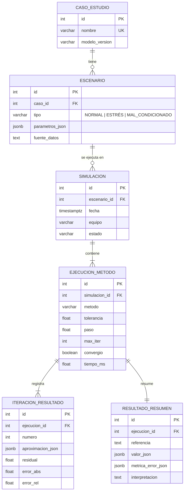

# DER y modelo relacional (SIMTELE-RISK)

Pega el bloque `mermaid` en https://mermaid.live para exportarlo como PNG/SVG para el informe.

## Modelo relacional

- `caso_estudio(id PK, nombre UNIQUE, modelo_version)`
- `escenario(id PK, caso_id FK→caso_estudio, tipo CHECK, parametros_json, fuente_datos)`
- `simulacion(id PK, escenario_id FK→escenario, fecha, equipo, estado)`
- `ejecucion_metodo(id PK, simulacion_id FK→simulacion ON DELETE CASCADE, metodo, tolerancia, paso, max_iter, convergio, tiempo_ms)`
- `iteracion_resultado(id PK, ejecucion_id FK→ejecucion_metodo ON DELETE CASCADE, numero, aproximacion_json, residual, error_abs, error_rel)`
- `resultado_resumen(id PK, ejecucion_id FK→ejecucion_metodo ON DELETE CASCADE, referencia, valor_json, metrica_error_json, interpretacion)`

Nota: el DER de la consigna no incluye `usuario`; `equipo` es un campo opcional en `simulacion`.
Para ejecuciones con más de 500 iteraciones se guardan 500 iteraciones submuestreadas (incluye la primera y la última).
